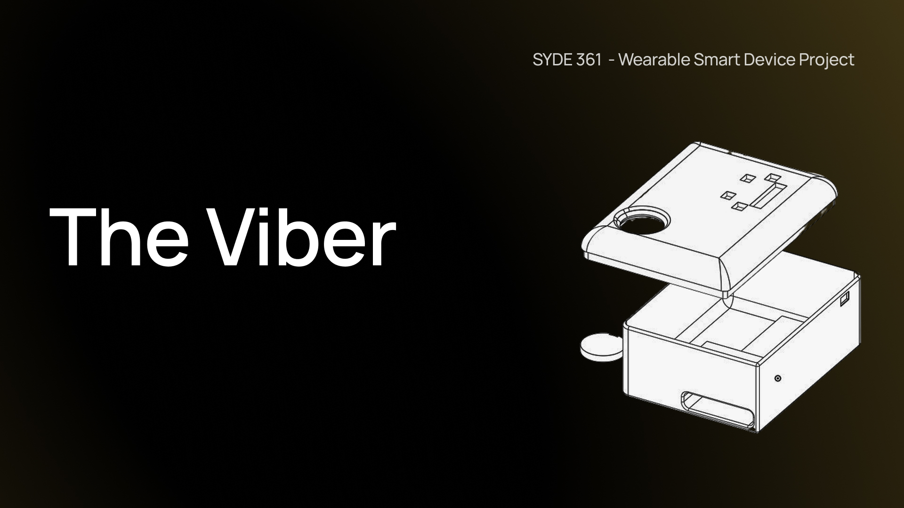

# Viber(ational awareness band)

Design Project

Other names thought of include: AlertBand, AlertVibe, VibeAlert

Components planned:
- Arduino Nano ESP32
- Pager vibrator
- Recheargeable 9V
- Step down buck converter (the ESP32 can't *actually* handle 9V well)
- Basic switch
- 3D-Printed PLA housing
- EVA foam, mic windscreen, velcro 

Headers used:
I2S Driver
ESP_DSP
